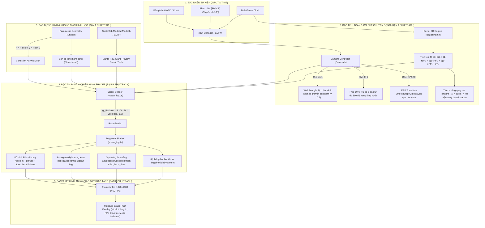

# 🏗️ ARCHITECTURE.md - KIẾN TRÚC HỆ THỐNG & PHÂN CÔNG KỸ THUẬT

**Dự án:** 3D Tropical Oceanarium Simulation (Mô Phỏng Thủy Cung Nhiệt Đới 3D Tương Tác)  
**Phân công nhóm:** 2 sinh viên (Bạn A: Backend/Math/Models - Bạn B: Frontend/Shaders/UI)  
**Chuẩn đồ họa:** OpenGL 3.3 Core Profile (C++) song hành nền tảng WebGL (Three.js r128 + GSAP)

---

## 1. CÔNG NGHỆ SỬ DỤNG (TECH STACK)

### 1.1. Hệ thống C++ / OpenGL (Bản nộp học thuật & chấm điểm thuật toán)
* **Ngôn ngữ:** C++17 (Modern C++, hướng đối tượng phân tách module rõ ràng).
* **Đồ họa cốt lõi:** OpenGL 3.3 Core Profile (Không dùng hàm cũ deprecated/Fixed-Function).
* **Quản lý cửa sổ & Sự kiện:** GLFW 3.3 (Xử lý bàn phím WASD, chuột, sự kiện phím `[SPACE]`).
* **Nạp hàm OpenGL:** GLAD (OpenGL Loader-Generator).
* **Thư viện Toán học:** GLM (OpenGL Mathematics: vector `vec3`, ma trận `mat4`, phép chiếu `perspective`, phép biến đổi `lookAt`, xoay Euler).
* **Nạp mô hình 3D:** Lightweight Wavefront OBJ Parser & Assimp/GLTF converter.
* **Biên dịch:** CMake 3.16+ / MinGW-w64 (GCC 8.1+ hoặc Clang).

### 1.2. Hệ thống WebGL / Three.js Companion (Bản trình diễn trải nghiệm mượt mà 60 FPS)
* **Engine 3D:** Three.js r128 (WebGL 2.0 / PBR Physically-Based Rendering).
* **Nạp mô hình Sketchfab thực tế:** `THREE.GLTFLoader` (Nạp trực tiếp `.glb` kèm Mesh, Normal Map, Roughness, Vảy kim loại).
* **Motion & Animation Engine:** GSAP 3.12 (GreenSock Animation Platform) xử lý chuyển động Easing, LERP camera mượt mà không giật cục.
* **Hiệu ứng nước & Ánh sáng:** Three.js DirectionalLight với bóng đổ PCFSoftShadowMap, Ambient Light nhiệt đới, Volumetric God Rays và Shader Caustics.

---

## 2. CẤU TRÚC THƯ MỤC DỰ ÁN & PHÂN QUYỀN TRÁCH NHIỆM

```
C:\Exercise\DHMT\Aquarium_3D\
├── PRD.md                         # [Chung] Tài liệu yêu cầu sản phẩm
├── ARCHITECTURE.md                # [Chung] Tài liệu kiến trúc và luồng dữ liệu
├── DESIGN.md                      # [Chung] Thiết kế giao diện, màu sắc, motion
├── RULES.md                       # [Chung] Quy tắc viết code & điều cấm kỵ của AI
├── TASKS.md                       # [Chung] Danh sách đầu việc chi tiết từng mốc
├── PROGRESS.md                    # [Chung] Nhật ký tiến độ, lỗi đã sửa & việc tiếp theo
├── CMakeLists.txt                 # [Bạn A] File cấu hình build CMake cho C++
├── build_mingw.bat                # [Bạn A] Script tự động build bằng MinGW g++
├── run.bat                        # [Bạn B] Script 1-click khởi chạy Web Server & Browser
├── index.html                     # [Bạn B] Ứng dụng WebGL tương tác Three.js + GSAP
│
├── include/                       # Thư mục mã nguồn Header C++
│   ├── Camera.h                   # [Bạn A] Hệ thống camera 6-DOF, FPS Walk & LERP Dive
│   ├── BezierPath.h               # [Bạn A] Giải thuật toán học đường cong Bézier 3D bậc 3
│   ├── Tunnel.h                   # [Bạn A] Giải thuật sinh lưới vòm kính tham số hình trụ
│   ├── Mesh.h                     # [Bạn A] Quản lý đỉnh VAO, VBO, EBO của mô hình
│   ├── Model.h                    # [Bạn A] Bộ đọc file 3D mesh và ánh xạ vật liệu
│   ├── Shader.h                   # [Bạn B] Trình quản lý nạp và biên dịch GLSL Shader
│   └── ParticleSystem.h           # [Bạn B] Hệ thống hạt bọt khí đại dương
│
├── src/
│   └── main.cpp                   # [Chung] Vòng lặp render chính (Game Loop) kết nối A & B
│
├── assets/
│   ├── models/                    # [Bạn A] Kho mô hình 3D sinh học thực tế từ Sketchfab
│   │   ├── manta_ray.glb          # Cá Đuối Manta khổng lồ
│   │   ├── shark.glb              # Cá Mập Hổ đại dương
│   │   ├── turtle.glb             # Rùa Biển đồi mồi
│   │   ├── tropical_fish.glb      # Đàn cá nhiệt đới san hô
│   │   ├── dolphin.glb            # Cá Heo mũi chai
│   │   ├── tuna.glb               # Cá Ngừ vây xanh
│   │   ├── whale.glb              # Cá Voi khổng lồ
│   │   └── giant_trevally.obj     # Cá Khế vây xanh (Vảy ánh bạc)
│   │
│   └── shaders/                   # [Bạn B] Bộ mã nguồn Shaders GLSL OpenGL 3.3
│       ├── ocean_fog.vs           # Vertex Shader: Chuyển vị trí đỉnh và véc-tơ pháp tuyến
│       └── ocean_fog.fs           # Fragment Shader: Blinn-Phong, Nắng Caustics & Fog xanh ngọc
│
└── lib/                           # Thư viện liên kết ngoài (GLFW, GLAD)
```

---

## 3. LUỒNG DỮ LIỆU TOÀN HỆ THỐNG (DATA FLOW DIAGRAM)



---

## 4. GIAO DIỆN KẾT NỐI (INTERFACE CONTRACTS) GIỮA BẠN A VÀ BẠN B

Để đảm bảo hai bạn làm việc song song không bao giờ xảy ra lỗi xung đột (conflict):

### 4.1. Contract 1: Quản lý Camera & Chuyển đổi chế độ (`Camera.h`)
* **Bạn A cung cấp cho Bạn B:**
  ```cpp
  glm::mat4 Camera::GetViewMatrix();
  glm::mat4 Camera::GetProjectionMatrix(float fov, float aspect, float nearPlane, float farPlane);
  glm::vec3 Camera::GetPosition();
  bool Camera::IsInTunnelMode(); // true: Đang ở trong hầm kính; false: Đang lặn tự do
  ```
* **Bạn B sử dụng:**
  Truyền vị trí `camera.GetPosition()` vào uniform `u_viewPos` trong shader để tính toán vector hướng nhìn $V$ cho ánh sáng phản xạ gương (Specular).

### 4.2. Contract 2: Quản lý Quỹ đạo Cá Bơi (`BezierPath.h`)
* **Bạn A cung cấp cho Bạn B:**
  ```cpp
  glm::vec3 BezierPath::Evaluate(float t);        // Tọa độ vị trí tại thời điểm chuẩn hóa t [0, 1]
  glm::vec3 BezierPath::GetTangent(float t);      // Vector tiếp tuyến chỉ hướng bơi của cá
  glm::mat4 BezierPath::GetModelMatrix(float t, glm::vec3 scale); // Ma trận biến đổi Model hoàn chỉnh
  ```
* **Bạn B sử dụng:**
  Lấy `GetModelMatrix` truyền vào uniform `model` của Vertex Shader khi vẽ từng con cá.

### 4.3. Contract 3: Quản lý Shaders & Uniforms (`Shader.h`)
* **Bạn B cung cấp cho Bạn A:**
  ```cpp
  void Shader::use();
  void Shader::setMat4(const std::string &name, const glm::mat4 &mat);
  void Shader::setVec3(const std::string &name, const glm::vec3 &value);
  void Shader::setFloat(const std::string &name, float value);
  ```
* **Bạn A sử dụng:**
  Gọi hàm `shader.use()` và thiết lập ma trận ma trận `model`, `view`, `projection` trước mỗi lệnh vẽ `glDrawElements()`.
